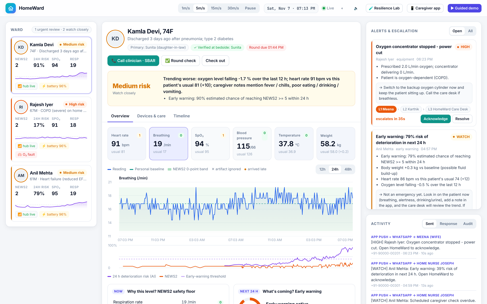

# HomeWard: a hospital ward that fits inside a bedroom

[](https://homeward-itmp.onrender.com/) [](https://github.com/mahak867/smart-health/actions/workflows/ci.yml)   

Built by Team **Smart Health** for **Operation Ward Zero**.

HomeWard watches a patient at home the way a good ward nurse would:
- it knows what is *normal for this patient*;
- it notices slow drifts hours before an emergency;
- it ignores sensor glitches;
- it watches the medical equipment, the medicines and the bed;
- it understands what the family writes, in English, Hindi, Hinglish, Tamil or Tanglish;
- it makes sure a human responds.

It keeps working when the Wi-Fi, the power, the AI or the bedside hub fails.

```
 SENSE ─────────────► UNDERSTAND ─────────────► PREDICT ────────────► ALERT ──────────────► RESPOND
 bedside hub          quality gate                24 h early warning    Low / Medium / High   caregiver app (हिन्दी/EN)
 vitals, pill box,    NEWS2 safety floor          (explainable AI)      + short reason        care-desk dashboard
 bed + motion,        personal baseline           rule fallback         confirmed, de-duped   escalation ladder, SBAR
 O₂ concentrator,     notes (EN/HI/TA)                           escalation timers     verified attendance, audit
 power, store&forward
```

## ▶ Try it live: **https://homeward-itmp.onrender.com/**

Sign in as **Nurse Asha · PIN 1234** (care desk), then press **▶ Guided demo**. Family view: Sunita **1111** · Meena **2222** · Joseph **3333**.
*Free hosting sleeps when idle, so the first visit may take about a minute to wake up.*



🎬 **Demo video:** [docs/demo/HomeWard-demo-video-voiceover.mp4](docs/demo/HomeWard-demo-video-voiceover.mp4) (2:40, with voice-over)

## Run it in 60 seconds

You need Python 3.10 or newer. No Docker, no database server, no API keys and no hardware.

```bash
pip install -r requirements.txt
python run.py
```

Then open:

| URL | What |
|---|---|
| **http://127.0.0.1:8000** | Care-desk dashboard. Sign in as **Nurse Asha, PIN 1234**, then press **▶ Guided demo** for the full story in under 3 minutes. |
| **http://127.0.0.1:8000/caregiver?lang=hi** | Family-caregiver phone app (Hindi/English). Sign in as Sunita **1111**, Meena **2222** or Joseph **3333**; each sees only their own patient. |
| **http://127.0.0.1:8000/docs** | Interactive API documentation |

To run the 144 automated safety, resilience and privacy tests:

```bash
pytest -q
```

The real-browser suite (22 end-to-end checks in Chromium: login, roles, alerts, phone app, Resilience Lab, guided demo) runs too when Node and Playwright are installed (`npm i playwright && npx playwright install chromium`). GitHub Actions runs both on every push.

Docker works too: `docker build -t homeward .`, then `docker run -p 8000:8000 homeward`. A `render.yaml` gives a one-click public demo.

## Deliverables checklist

| Required | HomeWard |
|---|---|
| **IoT simulation**: simulate sensors and send data to the platform | One simulated **bedside hub per home** (`homeward/edge.py`) uploads over real HTTP: vitals patch and oximeter, smart scale, **smart pill box**, **bed + room-motion sensors**, **oxygen concentrator** and hub power. It stores readings first (SQLite outbox) and uploads in ordered, sequence-numbered batches. An optional ₹1,000 ESP32 kit uses the same pipeline ([hardware/](hardware/README.md)). |
| **Platform**: display readings, raise and acknowledge alerts | Live dashboard (Server-Sent Events) with charts, explanations and an alert queue with escalation timers. Acknowledge/resolve from the dashboard, the phone app or a physical bedside button. |
| **AI risk**: Low / Medium / High with a short reason, using English caregiver notes | Every patient has a **Low / Medium / High** risk and a one-line reason, e.g. *"Trending worse: oxygen level falling -1.5 % over the last 12 h; heart rate 88 vs usual 81; caregiver notes mention fever / chills."* Notes are understood in **English, Hindi, Hinglish, Tamil and Tanglish**, with negation ("bukhar nahi hai", "kaaichal illai"), and the detected language is shown back. |
| **Technical documentation** | [docs/TECHNICAL.md](docs/TECHNICAL.md) · [docs/MODEL_CARD.md](docs/MODEL_CARD.md) · [hardware/README.md](hardware/README.md) |
| **3-minute demo video** (Sensor → Platform → AI Risk → Alert → Caregiver Response) | The **▶ Guided demo** button plays exactly this story with captions (about 2 min 50 s). See [docs/DEMO_SCRIPT.md](docs/DEMO_SCRIPT.md). |
| **Source code + README + data/config** | This repository. The model is trained by `python -m homeward.train`, and patients and scenarios are defined in `homeward/physiology.py`. |

## The hints, all covered

| Hint | How HomeWard does it |
|---|---|
| Monitor vitals **and medical equipment** in real time | HR, RR, SpO₂, BP, temperature and weight every 5 min. The oxygen concentrator's flow and purity are monitored like a vital sign. If it stops or degrades, an equipment alert says *"switch to the backup cylinder"*. |
| **Verify caregiver attendance** and activity | Check-in by scanning a **bedside tag** (verified presence). Scheduled round checks raise an alert if overdue. Acknowledgement times are tracked per responder. The bedside button also counts as proof of presence. |
| Keep working through **connectivity and power** disruptions | The edge hub stores and forwards readings and **sounds an in-room alarm while offline**. During a **power cut** it runs on battery and keeps monitoring. Ingestion is idempotent and order-independent. Old data is never shown as "stable". An **AI circuit breaker** falls back to rules. |
| Combine vitals, patient context and **multilingual caregiver notes** | Personal baseline, diagnosis-aware scoring (COPD Scale 2), medicines and missed doses, and notes in English, Hindi, Hinglish, Tamil and Tanglish. A note saying *"confused"* counts as new confusion in NEWS2. |
| **Predict deterioration 24–48 h ahead** and escalate | An explainable model forecasts the chance of reaching NEWS2 ≥ 5 within 24 h. On held-out test patients: **median 10.2 h of warning vs 6.0 h for NEWS2 alone**, and **0.115 vs 0.265 false alerts per stable patient-day**. Escalation ladder: caregiver → family → tele-nurse → ambulance. |
| **Usability, privacy, clinical safety** | Hindi-first caregiver app with big buttons and voice notes. **Role-based access:** the care desk sees all homes, while a family member sees only their own patient. Hashed PINs, server-side sessions, lockout after 5 wrong PINs, every record opening and denied access audited, and the actor always taken from the session. Device keys. Built on NEWS2, the published hospital early-warning score. CRITICAL needs two confirmed readings. Exact explanations. No diagnosis language. |

## Why HomeWard stands out

1. **A clinical safety floor that clinicians already trust.** Every reading is scored with NEWS2, including **SpO₂ Scale 2** for COPD patients on oxygen. The AI can only add earlier warning; it can never lower what NEWS2 says.
2. **Personal, not generic.** The first 24 h teach the system each patient's own normal.
3. **Measured early warning.** Lead time and false-alarm rate are measured against NEWS2 alone on held-out patients and shown in the app. Sudden events can't be forecast, and the app says so.
4. **Explanations are the model.** Logistic regression with **clinically signed coefficients**: every bar shown is the model's exact maths, and no factor can push risk in a medically impossible direction.
5. **Engineered against alarm fatigue.** Signal-quality gate, confirmation, de-duplication, severity upgrades instead of repeat alerts, and a 30-minute step-down hysteresis.
6. **A Resilience Lab you can break.** Live switches for internet outage, power cut, duplicate storm, late data, AI crash and hub failure, with counters showing what was absorbed.
7. **The whole home, not just a pulse.** Pill box, bed + motion fall detection, oxygen equipment, power and caregiver presence.
8. **Ready for real devices.** ESP32 firmware (MAX30102 + temperature, buzzer, LED, acknowledge button, offline alarm), a USB serial bridge and a virtual ESP32 for testing.

## Repository layout

```
run.py                     one command: platform + 3 simulated homes
homeward/
  physiology.py            patients, vitals generator, deterioration scenarios
  edge.py                  bedside hub: sensors, pill box, bed/motion, O₂ equipment, power, outbox, in-room alarm
  quality.py               signal-quality / artifact gate
  news2.py                 NEWS2 incl. SpO₂ Scale 2
  features.py              personal baseline, trends, model features
  model.py                 explainable predictor, circuit breaker, rule fallback
  train.py                 cohort generation, training, held-out evaluation
  notes.py                 English / Hindi / Hinglish / Tamil / Tanglish note understanding
  engine.py                ingestion, risk, Low/Medium/High + reason, alerts, escalation, watchdogs, SBAR
  auth.py                  role-based access: hashed PINs, sessions, lockout, per-patient scoping
  server.py                FastAPI: device, dashboard, streaming and demo APIs
web/                       dashboard, guided demo, caregiver app (no build step, works offline)
hardware/                  ESP32 firmware, serial bridge, virtual ESP32, wiring + BOM
tests/                     144 pytest checks + 22-check real-browser E2E suite (tests/e2e)
scripts/fast_forward.py    prints a 40 h alert timeline in seconds
docs/                      technical doc, model card, demo script, screenshots
```

**Quality:** 144 unit / integration / resilience / privacy tests, including every NEWS2 threshold boundary; 22 real-browser end-to-end checks; CI on every push.

**Stack:** Python · FastAPI · SQLite (WAL) · NumPy · httpx · Server-Sent Events · vanilla HTML/CSS/JS with canvas charts · pytest · Playwright · Arduino (ESP32).

NEWS2 thresholds are from the Royal College of Physicians *National Early Warning Score 2* (2017). AI coding assistants were used during development, and the team can explain every component.
